# MArchivos

Gestor de archivos para el ordenador y el móvil: tus nubes, tus servidores (carpetas compartidas, FTP, SFTP y WebDAV) y tu equipo en un solo sitio, para copiar y mover entre todos con las conexiones guardadas cifradas.

**Aplicación gratuita para Windows y Android desarrollada por [Masoft.es](https://masoft.es)**

- **Windows 1.1.2:** [instalador](https://github.com/MaSoft/MArchivos/releases/download/escritorio-v1.1.2/MArchivos_Setup_v1.1.2.exe) o [ejecutable único](https://github.com/MaSoft/MArchivos/releases/download/escritorio-v1.1.2/MArchivos_v1.1.2.exe)
- **Android 1.4.5:** [APK](https://github.com/MaSoft/MArchivos/releases/download/android-v1.4.5/MArchivos-1.4.5.apk)

Más información y los manuales también en [masoft.es](https://masoft.es/descargas.html#marchivos).

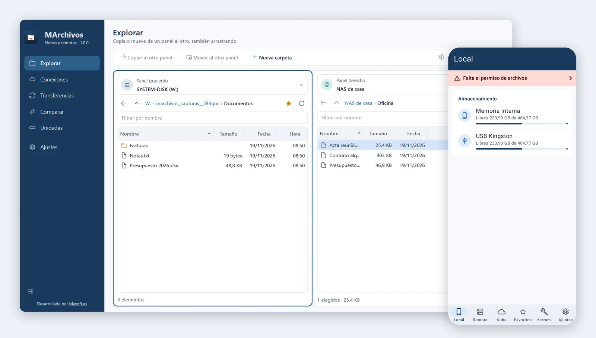

Son dos aplicaciones independientes con el mismo nombre: cada una da de alta sus propias nubes y servidores, y el PC y el móvil no se sincronizan entre sí.

## Windows 1.1.2

**Windows 10 / 11 · 64 bits** · [Página de la versión](https://github.com/MaSoft/MArchivos/releases/tag/escritorio-v1.1.2)

- **Instalador:** [`MArchivos_Setup_v1.1.2.exe`](https://github.com/MaSoft/MArchivos/releases/download/escritorio-v1.1.2/MArchivos_Setup_v1.1.2.exe) · 47,6 MB · SHA-256 `822c81cf75515174b5fdc654694564ab0d10e644b8943c9b631ddc4fd9f50909`
- **Ejecutable único (sin instalar):** [`MArchivos_v1.1.2.exe`](https://github.com/MaSoft/MArchivos/releases/download/escritorio-v1.1.2/MArchivos_v1.1.2.exe) · 67,8 MB · SHA-256 `9b177f1a53bffbf14ae5ff4cb4bc97aa9e5b1a2187245c58395c427e4d42aaa0`

### Qué hace
- Dos paneles, cada uno en una nube (OneDrive, Google Drive, Dropbox, Box, pCloud, Yandex Disk, MEGA, S3), un servidor o una unidad de tu equipo.
- Copiar y mover entre todo con botones, clic derecho o arrastrando de un panel al otro.
- Siempre comprobado: al terminar se mira el destino de verdad y, al mover, el original solo se quita si llegó igual.
- Copia en el servidor: dentro de la misma conexión los datos no pasan por tu equipo.
- Cola de transferencias con avance, velocidad y tiempo restante; pausar, reanudar, reintentar o descartar, historial e informe HTML.
- Comparar dos carpetas (solo en A, solo en B, distinto e igual) con su avance, aunque tengan cientos de miles de archivos; copiar lo que marques o borrar de A o de B lo que sobra.
- Una nube o un servidor como letra de unidad en el Explorador.
- Espacio usado y libre de cada nube, tamaño de cualquier carpeta, enlace para compartir, vista previa de imágenes y texto, y favoritos.
- Buscar en la red los equipos con carpetas compartidas, SFTP o FTP.
- Conexiones cifradas que solo abre tu usuario de Windows en ese equipo.

### Requisitos

| | |
|---|---|
| Sistema | Windows 10 u 11 de 64 bits |
| Instalación | Instalador para tu usuario, sin permisos de administrador, o ejecutable único que se copia y se abre; no hace falta instalar nada más. |
| Internet | Para las nubes; los servidores de tu red funcionan sin él. |
| Unidades | Para poner una nube o un servidor como letra de unidad hace falta WinFsp (gratuito). |

### Capturas

| | |
|---|---|
| 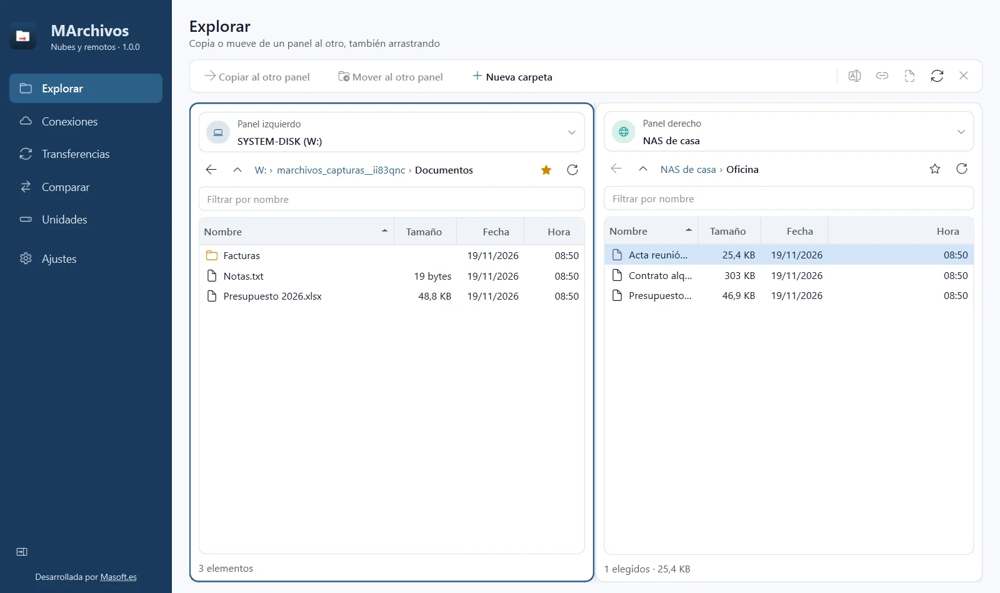 **Dos paneles.** Tu equipo a un lado y el servidor al otro: copiar o mover arrastrando. | 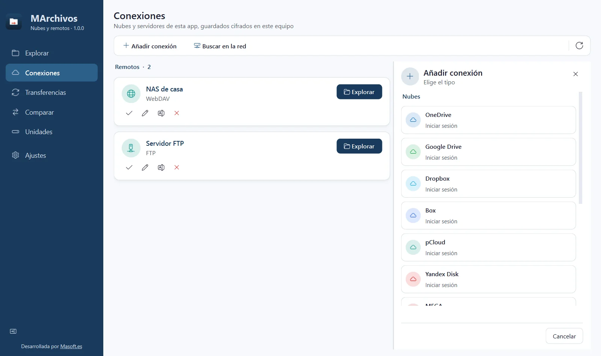 **Conexiones.** Nubes y servidores; se añaden eligiendo el tipo. |
| 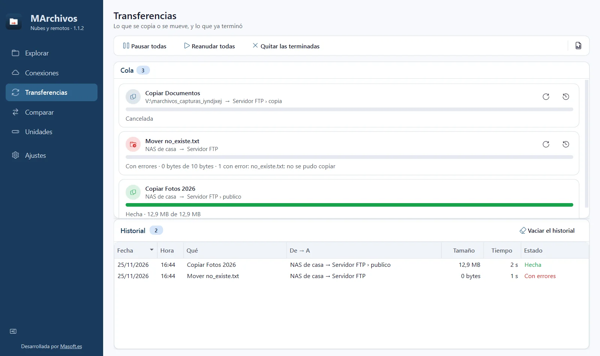 **Transferencias.** Cola con avance, historial y estado de cada una. | 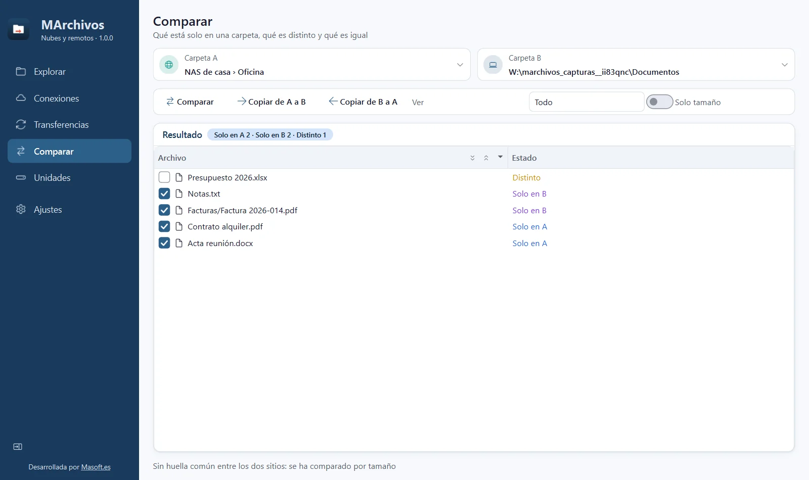 **Comparar.** Qué está solo en una carpeta, qué es distinto y qué es igual, con su avance. |

## Android 1.4.5

**Android 13 o superior** · [Página de la versión](https://github.com/MaSoft/MArchivos/releases/tag/android-v1.4.5)

- **APK:** [`MArchivos-1.4.5.apk`](https://github.com/MaSoft/MArchivos/releases/download/android-v1.4.5/MArchivos-1.4.5.apk) · 75,5 MB · SHA-256 `b7fab2ece6e798030642996c1096a4e17bf49f954d3a9588b657ded60ced2120`

### Qué hace
- Memoria interna, tarjeta SD y pendrives o discos por USB (OTG), con el espacio libre de cada uno.
- Servidores SMB, FTP (con o sin TLS), SFTP y WebDAV, y Red local para encontrar los equipos de tu red.
- Nubes con inicio de sesión en el navegador del móvil, sin registrar nada aparte.
- Copiar y mover entre todo, con avance, Cancelar y qué hacer si ya existe.
- ZIP: crear y extraer (también TAR, GZ y XZ), también en servidores.
- Papelera con Deshacer, favoritos, buscar, filtrar y ordenar.
- Herramientas: analizar el espacio, archivos grandes y duplicados.
- Visor de imágenes con recortar y girar, y reproductor de vídeo y música con gestos y subtítulos.
- Instalar APK, enviar por Bluetooth, acceso desde el PC (el móvil hace de servidor FTP o WebDAV) y huella MD5 y SHA-256.
- Contraseñas cifradas en el almacén seguro del móvil y copias de seguridad cifradas con tu contraseña.

### Requisitos

| | |
|---|---|
| Sistema | Android 13 o superior, 64 bits |
| Instalación | Se descarga el APK en el móvil y se abre; Android pide permiso para instalar aplicaciones de esa fuente. |
| Permisos | Acceso a todos los archivos (obligatorio), Instalar aplicaciones (para los APK) y Avisos (avance al copiar). |
| Red | Para servidores y nubes; el acceso desde el PC necesita la misma Wi-Fi. |

### Capturas

| | |
|---|---|
| 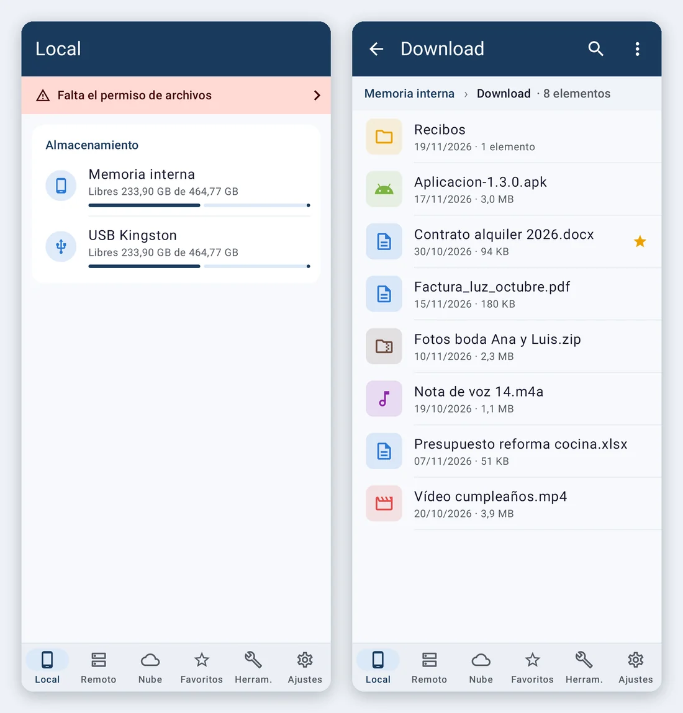 **Local.** Unidades del móvil y sus carpetas. | 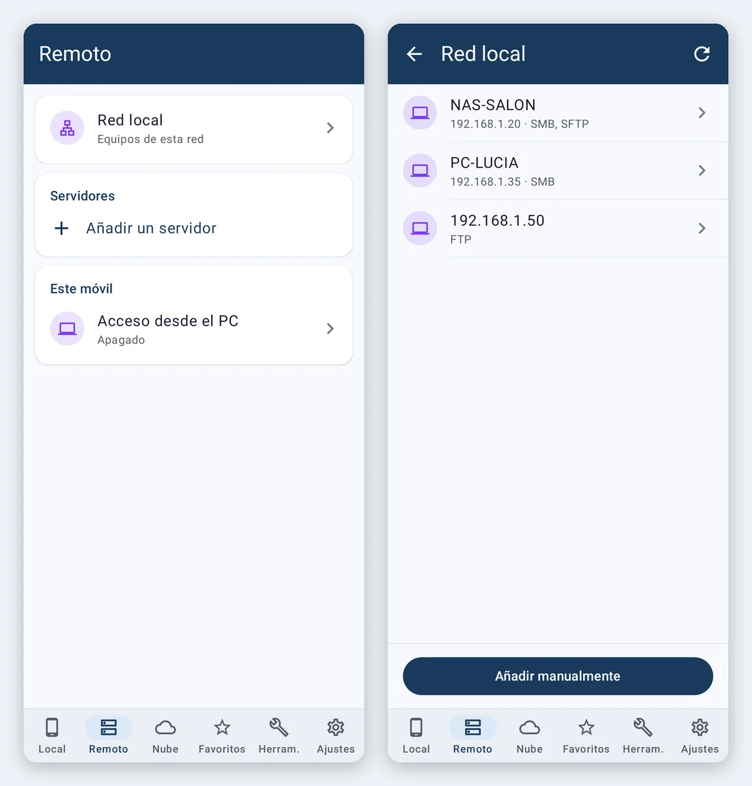 **Servidores y red local.** Tus conexiones y los equipos de tu red. |
| 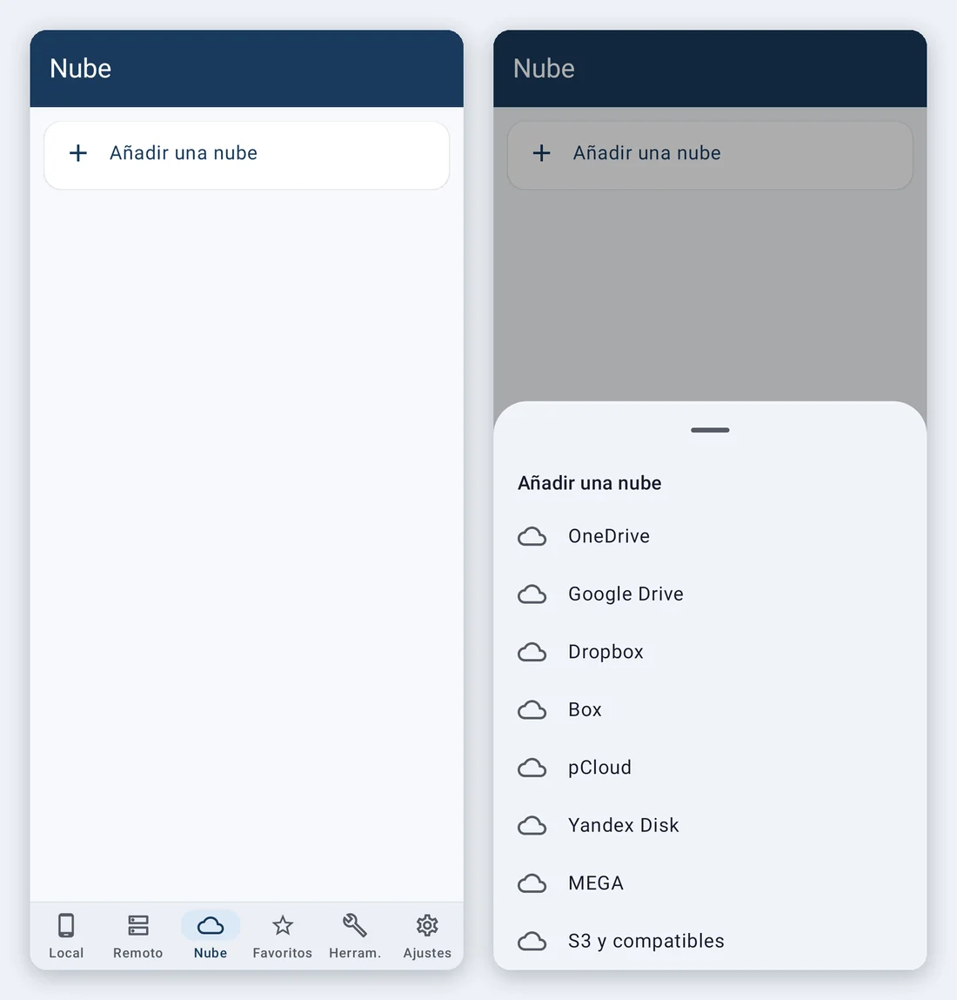 **Nubes.** Las nubes por proveedor y añadir una nueva. | 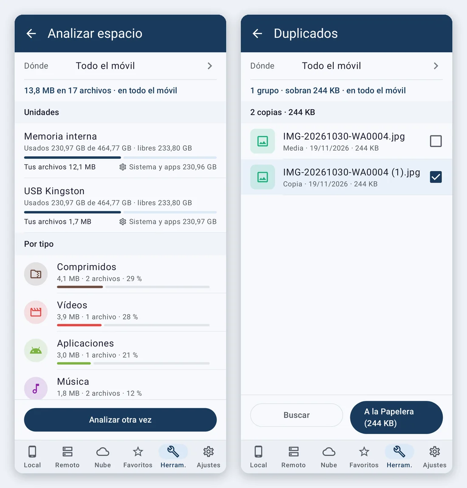 **Herramientas.** Analizar el espacio y los duplicados. |
| 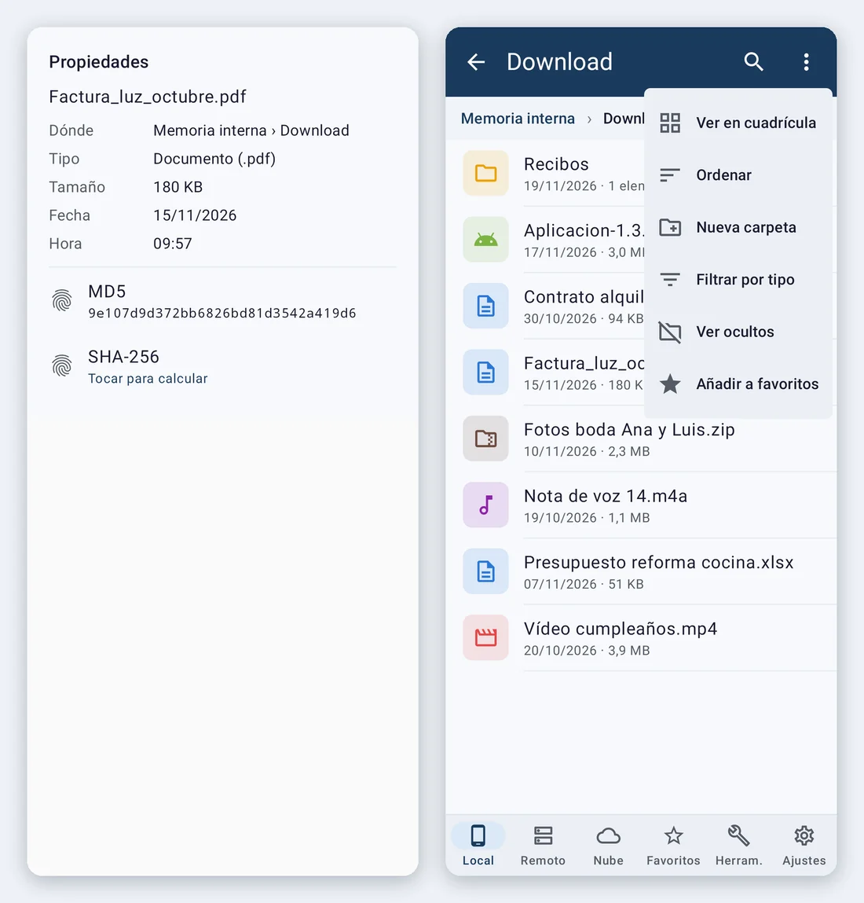 **Propiedades y acciones.** Tamaño, huellas y lo que se puede hacer con cada archivo. | 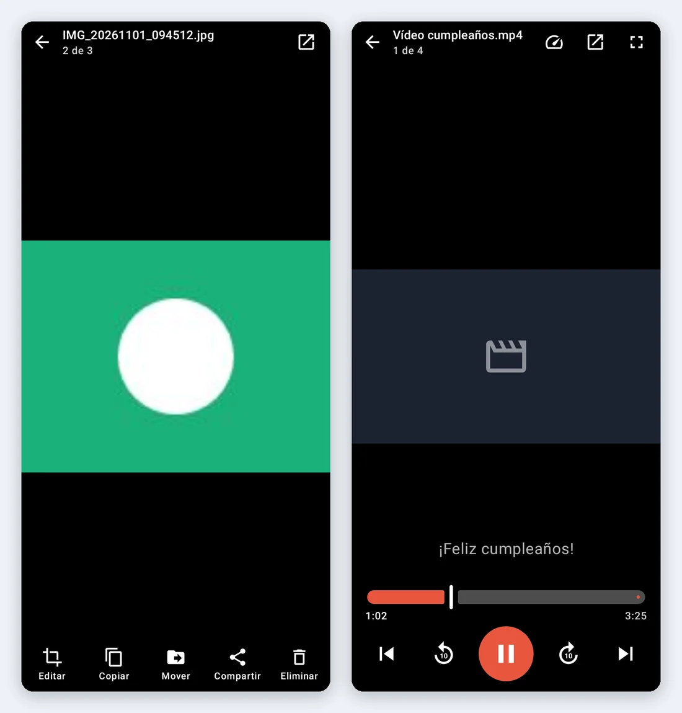 **Visor y reproductor.** Imágenes y vídeos dentro de la app. |

## Instalación y comprobación

- **Windows:** el instalador y el ejecutable no están firmados digitalmente: Windows puede mostrar «Windows protegió su PC». Pulsa «Más información» y «Ejecutar de todas formas».
- **Android:** la aplicación no está en Google Play. Se descarga el APK en el móvil y se abre; Android pide permiso para instalar aplicaciones de esa fuente y Google Play Protect puede avisar de que no conoce la aplicación.

Para comprobar una descarga, en PowerShell `Get-FileHash .\<archivo>` debe dar la huella SHA-256 de arriba.

## Aviso legal

MArchivos es gratuito y se entrega tal cual, sin garantía de ningún tipo. Al descargarlo y usarlo aceptas el aviso legal y las limitaciones de su manual.

> ⚠ Uso bajo tu responsabilidad. MArchivos Escritorio copia, mueve y elimina archivos en tus nubes, servidores y en este equipo según lo que pidas. Revisa el destino antes de mover o eliminar.
> ⚠ Uso bajo tu responsabilidad Borrar en remotos y nubes es definitivo. Revisa lo elegido antes de confirmar.

**Limitaciones y exclusión de responsabilidad**
- Las nubes y servidores se usan con rclone (software libre, licencia MIT), incluido en la app.
- Algunos servicios limitan cuántas operaciones aceptan por minuto: se avisa y hay que esperar.
- Google Drive usa el acceso compartido de rclone; Google puede limitarlo o retirarlo.
- Eliminar en un remoto no se puede deshacer; en las nubes depende de su propia papelera.
- Las unidades necesitan WinFsp (de terceros, gratuito) y solo existen mientras la app está abierta.
- MArchivos no envía tus datos a ningún sitio que no sea la nube o el servidor que tú eliges.
- Esta aplicación se proporciona tal cual , sin garantía de ningún tipo.
- El autor no se hace responsable de pérdidas de datos derivadas de su uso, incluidas las eliminaciones confirmadas por el usuario.
- Remotos y nubes se manejan con rclone (licencia MIT), incluido en la app sin cambios. Los .xz se leen con XZ for Java (licencia 0BSD).
- El acceso desde el PC usa FTP o WebDAV sin cifrar dentro de la Wi-Fi: enciéndelo solo en redes de confianza y apágalo al terminar.
- Quien tenga el móvil desbloqueado puede usar las conexiones guardadas: protégelo con el bloqueo de pantalla.

Este repositorio solo contiene las aplicaciones compiladas y su documentación. © Masoft.es. Todos los derechos reservados.
